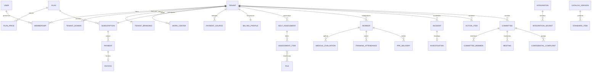
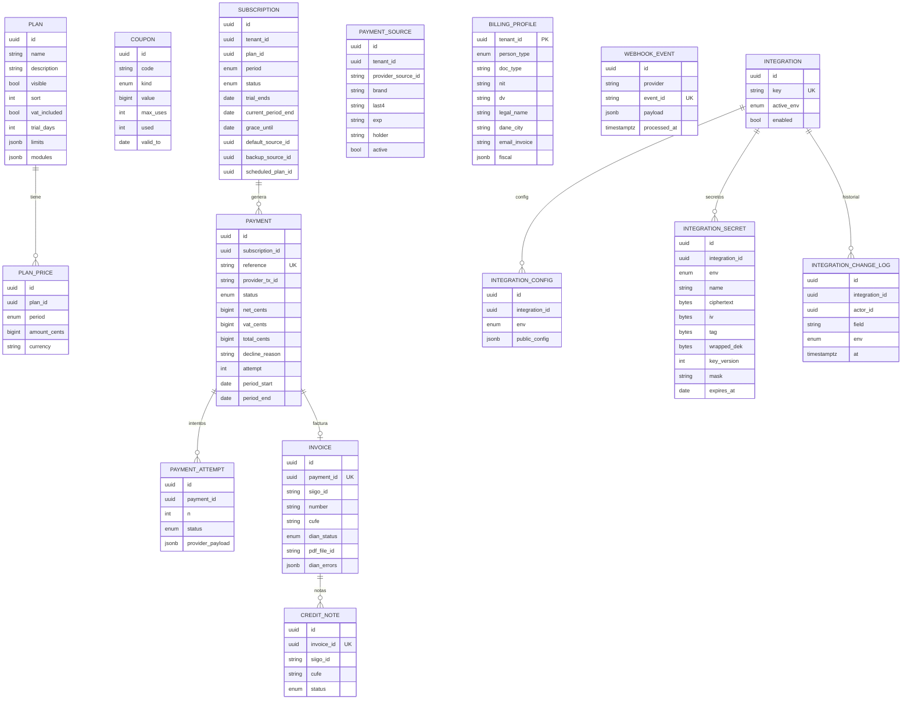
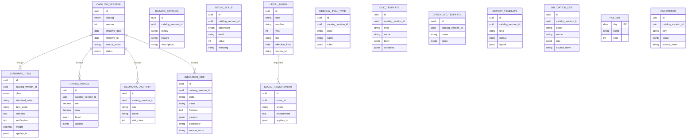

# Arquitectura propuesta — Plataforma SaaS SG-SST (Colombia)

Estado: **propuesta para aprobación. No hay código escrito.**
Base: `docs/PRODUCT_SPEC.md` (secciones 1–11).

---

## 1. Principios de diseño

1. **Normativa = datos.** Todo plazo, rango, fórmula o periodicidad vive en catálogos versionados (fuente, vigencia). El código solo los interpreta. Lo que no tenga certeza se marca `TODO-NORMA`.
2. **Aislamiento en dos barreras.** Cada consulta de negocio corre dentro de una transacción con `SET LOCAL app.tenant_id` y RLS en Postgres; además, la capa de datos filtra por `tenantId`.
3. **Monolito modular.** Un solo proyecto Next.js desplegado en Vercel, con módulos por dominio y fronteras claras (cada módulo expone `actions`, `queries`, `schema`, `rules`).
4. **Reglas puras y testeables.** Puntaje 0312, indicadores, días hábiles, aptitud/periodicidades, ciclo de suscripción: funciones puras sin I/O, con Vitest.
5. **Dinero en enteros (centavos), fechas en UTC, presentación en `America/Bogota`.**
6. **Evidencia primero.** Todo registro relevante puede tener evidencias, firma y rastro de auditoría; la "carpeta de inspección" es una consulta sobre ese grafo.
7. **Datos sensibles por diseño.** Salud (solo aptitud/restricciones/recomendaciones) y convivencia: cifrados a nivel de campo + políticas RLS adicionales + registro de acceso.

---

## 2. Decisiones técnicas

| Tema | Decisión | Justificación | Alternativa descartada |
|---|---|---|---|
| ORM | **Drizzle** | RLS exige `SET LOCAL` dentro de transacción en cada request y migraciones con SQL manual (políticas, triggers, revokes). Drizzle permite definir `pgPolicy`, mezclar SQL crudo sin fricción, y funciona con el driver serverless de Neon sobre HTTP/WebSocket. Menor *cold start* que Prisma. | Prisma: el patrón de RLS vía extensiones + `$transaction` es incómodo y más pesado en serverless. |
| Autenticación | **Better Auth** | Configuración de proveedores como *factory* por request (lee Google/Microsoft de la BD cifrada), plugins nativos de 2FA TOTP, magic link y organizaciones; control total sobre el esquema (Drizzle). | Auth.js v5: soporta config perezosa pero 2FA TOTP y multi-tenant son manuales. |
| Cola/jobs | **Inngest** | Funciones con pasos, reintentos con backoff, idempotencia por evento, *fan-out* para envíos masivos, cron integrado y timeouts largos sin exceder límites de Vercel. Se adapta bien a facturación (Wompi → Siigo) y exportaciones. | QStash: más simple pero sin orquestación de pasos. |
| Cron | Vercel Cron solo como *disparador* → emite eventos a Inngest | Evita lógica pesada dentro del cron. | — |
| PDF | `@react-pdf/renderer` (marca por tenant) | Corre serverless sin Chromium; plantillas como componentes. Playwright/Chromium solo si un formato oficial lo exige. | — |
| Cifrado de secretos | Sobre (envelope) AES-256-GCM: `ENCRYPTION_MASTER_KEY` (env) envuelve una DEK por secreto; se guarda `ciphertext, iv, tag, wrapped_dek, key_version` | Permite rotar la llave maestra sin re-cifrar todo. | — |
| Cifrado de campos sensibles | Mismo esquema + **blind index** (HMAC) para buscar por número de documento sin descifrar | Búsqueda por cédula sin exponer el dato. | — |
| Tenant por dominio | Middleware + **Edge Config** (`host → tenantId`), con caída a consulta en BD | Latencia baja en el edge. | — |
| Auth multi-dominio | Dominio central `auth.` + token de un solo uso (≤60 s, firmado, ligado a `tenantId` y *nonce*) que crea sesión en el dominio del tenant | Spec 5.9. Cookies solo `host-only` en cada dominio. | Cookies compartidas: no funcionan con dominios propios. |
| Offline | Service worker (Serwist) + IndexedDB; cada registro lleva `clientUuid` (UUID v7) como **llave de idempotencia** | Sincronización segura y reintentable. | — |
| Gestor de paquetes | pnpm, un solo paquete (sin monorepo) | Simplicidad; un solo despliegue. | Turborepo: sobreingeniería por ahora. |
| Identificadores | UUID v7 en todas las tablas | Ordenables, seguros para offline. | — |
| Idioma del código | Identificadores en inglés, UI y términos legales en español | Convención de la industria; términos como `copasst`, `ccl`, `furat` se conservan. (Ver pregunta 12.) | — |

---

## 3. Estructura de carpetas

```
/
├─ docs/                     PRODUCT_SPEC.md, ARQUITECTURA_PROPUESTA.md, runbooks
├─ CLAUDE.md
├─ drizzle/                  migraciones SQL versionadas (incl. RLS, triggers, grants)
├─ scripts/                  seed, utilidades, verificación de RLS
├─ e2e/                      Playwright
├─ public/                   manifest, íconos, sw
├─ src/
│  ├─ app/
│  │  ├─ (marketing)/        landing, precios, registro
│  │  ├─ (auth)/             login, magic link, selector de empresa, 2FA
│  │  ├─ (tenant)/           app de la empresa (PHVA, portal trabajador)
│  │  ├─ (platform)/         panel SUPER ADMIN (dominio admin.)
│  │  └─ api/                webhooks (wompi), inngest, cron, auth, vercel-domains
│  ├─ middleware.ts          resolución de host → contexto (marketing | admin | auth | tenant)
│  ├─ core/
│  │  ├─ db/                 cliente Neon, withTenant(), withPlatform(), schema/
│  │  ├─ tenancy/            contexto, resolución de dominio, límites de plan
│  │  ├─ auth/               Better Auth, proveedores dinámicos, handoff, 2FA
│  │  ├─ rbac/               permisos módulo×acción, guards, políticas de datos sensibles
│  │  ├─ crypto/             envelope, blind index, enmascarado
│  │  ├─ audit/              log inmutable, access log de datos sensibles
│  │  ├─ storage/            Vercel Blob, URLs firmadas, validación de archivos
│  │  ├─ mail/               Resend + React Email con marca por tenant
│  │  ├─ pdf/ excel/ export/ generadores y cola de exportaciones
│  │  ├─ signature/          firma simple (táctil/OTP) + evidencia + hash
│  │  ├─ calendar/           días hábiles, festivos, obligaciones, iCal
│  │  ├─ branding/           CSS vars, contraste WCAG AA
│  │  ├─ offline/            cola IndexedDB, sync, idempotencia
│  │  └─ jobs/               funciones Inngest, cron dispatchers
│  ├─ integrations/
│  │  ├─ payments/           interfaz PaymentProvider + wompi/
│  │  ├─ invoicing/          interfaz InvoicingProvider + siigo/
│  │  ├─ vercel-domains/
│  │  └─ registry/           centro de integraciones: secretos, ambientes, "probar conexión", caché
│  ├─ modules/
│  │  ├─ platform/           planes, cupones, suscripciones, métricas, anuncios, soporte, catálogos
│  │  ├─ billing/            portal de facturación de la empresa
│  │  ├─ onboarding/
│  │  ├─ planear/            política, estándares 0312, matriz legal, GTC 45, plan anual…
│  │  ├─ hacer/              trabajadores, medicina, capacitación, EPP, comités, emergencias…
│  │  ├─ verificar/          accidentes, inspecciones, indicadores, auditoría, rev. dirección
│  │  ├─ actuar/             CAPA
│  │  └─ transversal/        documentos, notificaciones, portal trabajador, búsqueda
│  │     (cada módulo: schema.ts · rules.ts · queries.ts · actions.ts · components/ · *.test.ts)
│  ├─ components/            ui/ (shadcn), layout/ (bottom-nav, sidebar), charts/
│  └─ lib/                   utilidades, zod compartidos, i18n es-CO
├─ vercel.json               crons
└─ .env.example
```

---

## 4. Multi-tenancy y RLS (cómo funciona)

- **Roles de BD**
  - `app_tenant`: sin `BYPASSRLS`. Todas las políticas exigen `tenant_id = current_setting('app.tenant_id')::uuid`.
  - `app_platform`: usado solo por `withPlatform()` (SUPER ADMIN/soporte). Cada uso escribe en `audit_log`. Para tablas de negocio se accede con política explícita `app.is_platform = 'true'`.
  - `app_owner`: dueño del esquema, solo migraciones.
- **`withTenant(ctx, fn)`**: abre transacción, ejecuta `SET LOCAL app.tenant_id`, `app.user_id`, `app.role`, y corre `fn`. Cualquier acceso fuera de este wrapper falla por no haber contexto (política por defecto = sin filas).
- **Datos sensibles (CCL, salud):** política RLS adicional que exige además `app.user_id` ∈ miembros activos del comité (o rol autorizado) y un `INSERT` automático en `sensitive_access_log` vía función de lectura (las consultas pasan por funciones `SECURITY DEFINER` o vistas controladas).
- **Test obligatorio:** suite que crea dos tenants, intenta leer/escribir cruzado por cada tabla con `tenant_id` (recorre `information_schema` para no olvidar tablas nuevas) y falla en CI si alguna tabla de negocio no tiene RLS activada.
- **Impersonación:** crea una sesión con `actingAs` + `impersonatedBy`, motivo obligatorio, expiración corta, banner visible, y todo queda en auditoría. Soporte = solo lectura.

---

## 5. Modelo de datos

Convenciones: `id uuid v7 PK`, `created_at`, `updated_at`, `created_by`, `deleted_at` (borrado lógico) en tablas de negocio. `tenant_id` en todas las tablas de la sección B. Dinero: `bigint` centavos. 🔒 = campo cifrado. ♻ = retención ≥ 20 años (sin borrado físico).

### 5.1 Mapa general (ER, nivel dominio)



### 5.2 Plataforma y facturación (ER)



Notas de diseño:
- `payment.reference` único e idempotente (`SUB-{subscriptionId}-{periodo}`); `webhook_event(provider, event_id)` único para idempotencia; `invoice.payment_id` único → un pago, una factura.
- `subscription.price_snapshot` (periodo, monto, IVA) para que un cambio de precio no afecte activas hasta renovar.
- Tabla `plan_siigo_product(plan_price_id, ambiente, siigo_code)` = mapeo plan/periodicidad → producto Siigo.

### 5.3 Catálogos normativos globales (sin `tenant_id`, versionados)



- `PARAMETER` guarda los plazos y periodicidades que el spec exige parametrizables (2 días hábiles AT, 15 días investigación, 20 días adaptación de puesto, 90 días retorno, periodos de comité, etc.), cada uno con `source_norm`.
- Los registros del tenant guardan **la versión del catálogo con la que se calcularon** (p. ej. `self_assessment.catalog_version_id`) → resultados históricos reproducibles.

### 5.4 Tenant, identidad y acceso

| Tabla | Campos clave |
|---|---|
| `user` | id, email (único global), email_verified, name, password_hash, totp (cifrado), locale |
| `account` / `session` / `verification` | tablas de Better Auth (+ `impersonated_by`, `active_tenant_id`) |
| `platform_staff` | user_id, role (`SUPER_ADMIN`/`SOPORTE_PLATAFORMA`), 2fa_required |
| `tenant` | slug, legal_name, trade_name, status (`trial/active/past_due/suspended/cancelled`), nit, dv, ciiu, risk_class, arl, legal_rep, size_class (calculado), sso_only, allowed_email_domains[], retention_until |
| `tenant_domain` | tenant_id, host, kind (`subdomain/custom`), status (`pending/verified/error`), dns_records jsonb, ssl_status, last_check |
| `tenant_branding` | logo_light/dark, favicon, colores, contrast_report |
| `work_center` | tenant_id, name, address, dane_city, risk_class, workers_count |
| `membership` | tenant_id, user_id, role_id, status, worker_id?, expires_at (auditor externo) |
| `role` | tenant_id (null = plantilla de sistema), key, name |
| `role_permission` | role_id, module, action (`view/create/edit/delete/approve/export`), scope (`all/own/team/center`) |
| `invitation` | tenant_id, email, role_id, token_hash, expires_at |
| `consent` | user_id, doc_type (`terms/privacy/health_data`), version, accepted_at, ip |
| `audit_log` ♻ | id, tenant_id?, actor_id, impersonator_id?, action, entity, entity_id, before, after, ip, ua, at, `prev_hash/hash` (append-only: `REVOKE UPDATE, DELETE`) |
| `sensitive_access_log` ♻ | tenant_id, actor_id, entity, entity_id, reason, at |
| `file` | tenant_id, blob_key, name, mime, size, sha256, uploaded_by, visibility |
| `evidence_link` | file_id, entity_type, entity_id, note (polimórfica: un archivo puede evidenciar varios registros) |
| `signature` ♻ | tenant_id, entity_type, entity_id, signer_id, method (`touch/otp`), signed_at, ip, device, doc_hash, image_file_id |
| `notification` / `push_subscription` / `notification_pref` | in-app, correo, push |
| `saved_filter`, `search_index` | filtros guardados, búsqueda global (tsvector) |
| `usage_counter` | tenant_id, metric (`workers/users/centers/storage`), value → límites de plan en servidor |

### 5.5 PLANEAR

| Tabla | Campos clave |
|---|---|
| `sst_responsible` | tenant_id, user/worker, license_no, license_until, course50_cert, course50_date, refresher20_due |
| `policy` ♻ | tenant_id, kind (`sst/acoso/...`), version, body, status, approved_by, approved_at, next_review |
| `policy_acknowledgement` | policy_id, worker_id, read_at |
| `responsibility` / `accountability_record` | rol/cargo → responsabilidades; rendición anual |
| `budget` / `budget_line` / `budget_execution` | año, rubro, monto (centavos), ejecutado, evidencias |
| `self_assessment` ♻ | tenant_id, year, catalog_version_id, group (7/21/60), score, rating, status, reported_to_mintrabajo_at, reported_by |
| `assessment_item` | assessment_id, standard_item_id, status (`cumple/no_cumple/no_aplica`), na_justification, owner_id, observations, score_awarded |
| `improvement_plan_item` | assessment_item_id → genera `action_item` |
| `tenant_legal_requirement` | tenant_id, requirement_id, applies, status, owner, evidence |
| `legal_update_notice` | norm_id, tenant_id, seen_at |
| `hazard_matrix` ♻ / `hazard_matrix_version` | tenant_id, version, status, approved |
| `hazard_entry` | matrix_id, center_id, process, activity, task, routine, hazard_id, effects, controls (fuente/medio/individuo), nd, ne, np, nc, nr, acceptability, hierarchy_controls jsonb |
| `annual_plan` / `annual_plan_activity` | año, actividad, responsable, inicio, fin, recursos, estado, % ; firmas |
| `training_plan` / `training_plan_item` | tema, población, cronograma |
| `change_management` | descripción, impacto SST, estado, acciones |

### 5.6 HACER

| Tabla | Campos clave |
|---|---|
| `worker` ♻ | tenant_id, center_id, doc_type, doc_number 🔒 + `doc_hash` (blind index), names, birth_date, job_title_id, area, contract_type (incl. aprendiz/contratista), hire_date, exit_date, status, eps, afp, arl, arl_risk_class, caja |
| `contractor_company` / `contractor_worker` | contratistas y sus trabajadores |
| `contractor_ss_payment` | contractor_id, period (mes), paid, proof_file_id, due_date |
| `job_title` / `job_profile` / `profesiograma_requirement` | cargo, riesgos, exámenes requeridos y periodicidad |
| `medical_evaluation` ♻🔒 | worker_id, type_id (preingreso/periódica/egreso/postincapacidad/retorno/seguimiento), scheduled_at, done_at, ips, **aptitud**, **restricciones**, **recomendaciones**, cost_cents, next_due. **Sin historia clínica** (no existe campo para ello; bloqueo de pruebas embarazo/VIH/serología en validación y lista negra de texto) |
| `workstation_adaptation` | evaluation_id, due_date (20 días, parametrizable), status, evidencias → `action_item` |
| `absence` | worker_id, cause (común/laboral/licencia), from, to, days, est_cost_cents |
| `pve_program` / `pve_enrollment` / `pve_case` | osteomuscular, auditivo, cardiovascular, visual, psicosocial |
| `psychosocial_battery` | tenant_id, applied_at, psychologist_name, license, risk_level, next_due, plan_item_id |
| `training_course` / `training_session` / `training_attendance` | sesión, QR token, firma táctil → `signature` |
| `quiz` / `quiz_question` / `quiz_attempt` | evaluación con puntaje |
| `certificate` | attendance_id/quiz_attempt_id, file_id, número |
| `ppe_item` / `ppe_matrix` / `ppe_stock` / `ppe_delivery` | entrega con firma, vencimiento |
| `committee` | tenant_id, kind (`copasst/vigia/ccl`), center_id?, term_start, term_end |
| `committee_member` | committee_id, worker_id, seat (`principal/suplente`), side (`empleador/trabajadores`), active, confidentiality_signature_id |
| `election` / `election_candidate` / `election_vote_receipt` / `election_ballot` | **recibo** (quién votó) y **papeleta** (voto) en tablas separadas y desvinculadas para secreto del voto; escrutinio automático |
| `meeting` / `meeting_minutes` / `meeting_commitment` | actas (el CCL excluye info confidencial) |
| `ccl_complaint` ♻🔒 | tenant_id, center_id, channel, reporter (puede ser anónimo), body 🔒, status, deadlines; RLS por membresía activa del CCL |
| `ccl_complaint_event` | trámite, citaciones, conciliación, plazos, acta |
| `harassment_report` ♻🔒 | **canal separado** (acoso sexual / violencia de género): destinatarios = alta dirección / talento humano; nunca CCL |
| `brigade_member`, `brigade_training`, `brigade_dotation` | brigada |
| `emergency_plan`, `vulnerability_analysis`, `pon`, `drill` , `drill_evaluation` | emergencias y simulacros |
| `safety_equipment` / `equipment_inspection` | extintores, botiquines, camillas, vencimientos |
| `evacuation_route` | center_id, file_id |
| `work_permit_type` | configurable (alturas, confinados, caliente, eléctrico) con checklist y flujo de firmas |
| `work_permit` ♻ | tipo, worker, ubicación, checklist, firmas (`signature`), estado, plan de rescate |
| `height_certificate` | worker_id, level, issued, expires |
| `height_equipment` | inventario con certificación |
| `chemical` / `chemical_sds` / `chemical_storage` / `chemical_compatibility` | SGA |
| `vehicle`, `driver`, `vehicle_document`, `preop_inspection`, `road_incident` | PESV |
| `supplier_requirement` / `supplier_evaluation` | contratistas y proveedores |

### 5.7 VERIFICAR / ACTUAR

| Tabla | Campos clave |
|---|---|
| `unsafe_report` | tenant_id, center_id, type (acto/condición), description, photo, geo, reporter_id (nullable = anónimo), `client_uuid` UK, status → `action_item` |
| `incident` ♻ | type (accidente/incidente), severity, occurred_at, worker_id, center_id, body_part, injury_type, witnesses, `report_deadline_arl` (= 2 días hábiles, calculado), arl_reported_at, eps_reported_at, `client_uuid` UK |
| `investigation` ♻ | incident_id, deadline (15 d), method (árbol/5 porqués), immediate_causes, basic_causes, status, sent_to_arl_at |
| `investigation_team_member` | rol (COPASST/Vigía, responsable SST, jefe, etc.) |
| `lesson_learned` | divulgación y confirmaciones |
| `occupational_disease_case` ♻🔒 | calificación y seguimiento |
| `inspection` / `inspection_answer` / `inspection_finding` | checklist (versión de plantilla), `client_uuid` UK, hallazgo con foto → `action_item` |
| `indicator_value` | tenant_id, indicator_def_id, period, numerator, denominator, value, target, analysis |
| `audit_program` / `internal_audit` / `audit_finding` | auditoría interna |
| `management_review` ♻ | entradas Decreto 1072, conclusiones, decisiones, firmas |
| `action_item` | tenant_id, `source_type` + `source_id` (polimórfico: inspección, accidente, auditoría, autoevaluación, PVE, simulacro, queja…), kind (correctiva/preventiva/mejora), root_cause, owner_id, due_date, status, closed_at, closure_evidence, efficacy_check, escalation_level |
| `action_item_event` | historial y escalamiento |

### 5.8 Transversales

| Tabla | Campos clave |
|---|---|
| `document` ♻ / `document_version` | código, tipo, versión, estado, vigencia, aprobador, file_id, hash, `retention_until` |
| `master_document_list` | vista sobre `document` |
| `calendar_obligation` | tenant_id, definición del catálogo o personalizada, due_date, status, link a entidad |
| `export_job` | tenant_id, kind, format, status, params, file_id, requested_by (cola Inngest) |
| `platform_announcement` / `announcement_read` | banners por segmento |
| `support_ticket` / `support_message` | soporte básico |
| `offline_sync_log` | client_uuid, entity, resultado (para depuración e idempotencia) |

---

## 6. Flujos críticos (resumen)

- **Cobro recurrente:** cron diario → evento Inngest `billing/due` → crea `payment` con referencia idempotente → transacción Wompi con firma de integridad → webhook `transaction.updated` (verifica checksum, inserta `webhook_event` único, encola) → aprobado: extiende periodo + evento `invoicing/create` → Siigo (cliente → factura → PDF → Blob → correo). Rechazo: reintentos parametrizables, luego fuente de respaldo, luego gracia → suspensión de solo lectura. Conciliación diaria con ambos proveedores.
- **Login social con dominio propio:** `empresa.com` → `auth.` (OAuth) → callback → token de un solo uso → redirección a `empresa.com/auth/handoff` → sesión local. El token queda ligado a `tenantId`, `nonce` y expira en segundos.
- **AT/EL:** `incident` crea contador de 2 días hábiles (calendario de festivos) y de 15 días para investigación; alertas por correo/push; datos precargados FURAT.
- **Autoevaluación:** puntaje = Σ pesos de ítems "cumple" sobre Σ pesos aplicables (los "no aplica" justificados salen del denominador), con rangos del catálogo; ítems "no cumple" generan `action_item` automáticamente.
- **Carpeta de inspección:** job de cola recorre estándares → `evidence_link` → ZIP + índice PDF.

---

## 7. Riesgos identificados

| # | Riesgo | Mitigación |
|---|---|---|
| R1 | **Exactitud normativa**: transcribir los 60 estándares de la Res. 0312, GTC 45, Res. 1843/3461 de 2025, Circular 047 de 2025, etc. de memoria puede introducir errores | No inventar: cargar desde el texto oficial que aporten, marcar `TODO-NORMA` y exigir validación de un experto SST antes de producción |
| R2 | **Conflicto retención 20 años vs. cierre de cuenta / derecho de supresión (Ley 1581)** | Decisión legal: archivo cifrado "frío" tras cancelación para registros ♻, con exportación al cliente y borrado de lo no obligatorio (ver pregunta 7) |
| R3 | **Datos sensibles de salud y acoso**: responsabilidad legal alta | Cifrado de campo, RLS adicional, access log, minimización (sin historia clínica), consentimiento registrado, bloqueo de pruebas prohibidas |
| R4 | **RLS con pooling serverless**: fuga de contexto entre requests | Solo `SET LOCAL` dentro de transacción; nunca `SET` de sesión; test de aislamiento en CI; rol sin `BYPASSRLS` |
| R5 | **Wompi: cobro recurrente** depende de capacidades de la cuenta comercial (fuentes de pago por tarjeta/Nequi) y de sus términos | Validar en sandbox y con la cuenta real al inicio de Fase 1; contrato `PaymentProvider` para aislar |
| R6 | **Siigo/DIAN**: rechazos, resolución de numeración, requisitos de cuenta, límites de la API | Jobs idempotentes, cola de reintento, conciliación, mocks y cuenta de pruebas |
| R7 | **Dominios propios + OAuth + cookies**: complejidad de seguridad (open redirect, fijación de sesión) | Token de un solo uso ligado a tenant/nonce, `host-only` cookies, lista blanca de destinos desde `tenant_domain` verificado |
| R8 | **Límites de Vercel**: funciones, cron (frecuencia según plan), tamaño de ZIP/PDF | Todo lo pesado a Inngest, ZIP por streaming a Blob, jobs por lotes |
| R9 | **Offline**: conflictos y duplicados, fotos pesadas | `client_uuid` idempotente, "último en escribir" solo para campos simples, compresión en cliente, cola reintentable |
| R10 | **Voto electrónico del COPASST**: validez, secreto y unicidad | Separar recibo/papeleta, ventana de votación, acta automática; confirmar con experto que la modalidad sea aceptable |
| R11 | **Alcance enorme** (7 fases) | Entrega por fases con criterios de cierre; Fase 0 y 1 son la base de riesgo (pagos, multi-tenant) |
| R12 | **Trabajadores sin correo/celular de uso personal** | Ver pregunta 5: define cómo autentican en el portal |
| R13 | **Costos de infraestructura** (wildcard + dominios por API + Neon branching + Inngest + Resend + Sentry) | Estimación por tenant en Fase 0 para fijar precio y límites de plan |

---

## 8. Cómo cerraré cada fase

Tests Vitest en verde (reglas normativas, firmas de webhook, idempotencia), `typecheck` y `lint` limpios, test de aislamiento entre tenants, deploy de preview funcionando, prueba visual a 375 px, y resumen de lo hecho y lo pendiente (incluyendo lista de `TODO-NORMA`). `CLAUDE.md` se crea al inicio de la Fase 0 y se mantiene actualizado.
